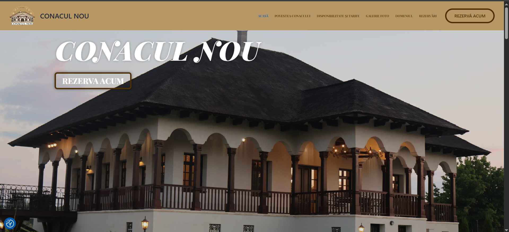
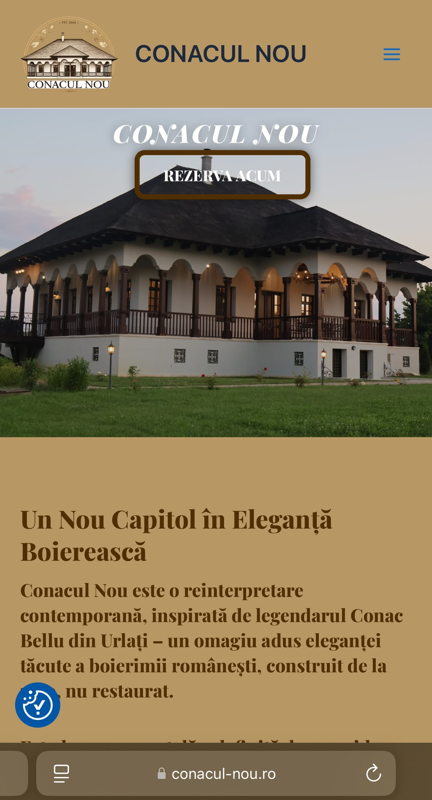

# Conacul Nou - Website & E-commerce Management

*Note: This repository serves as a portfolio showcase. The actual source code and database are hosted privately on the production server for security reasons.*

**Live Website:** [conacul-nou.ro](https://conacul-nou.ro)

A complete business website developed and managed for the "Conacul Nou" estate (Curtea de Argeș). Built using **WordPress**, this project focuses on seamless user experience, responsive design, and integrated e-commerce solutions for property rentals.

##  Project Showcase

##  Key Technical Implementations

* **CMS & Page Building:** Architected the site structure using WordPress, Elementor, and the Astra theme to ensure fast load times and a modern UI across Desktop and Mobile.
* **E-Commerce & Booking System:** Integrated and configured **WooCommerce** alongside WP Hotel Booking. Set up room pricing structures and direct bank transfer payment gateways (Banca Transilvania - Lei/Euro).
* **Automated Workflows:** Configured custom email notification triggers for both the administration team and customers upon booking confirmations or inquiries.
* **UI/UX Optimization:** Refined page content based on official brochures, optimized background video playback for performance, and resolved responsive design issues (e.g., header logo routing on mobile devices).
* **Domain & Server Administration:** Managed DNS settings, webmail (SiteBunker Roundcube), and server-side configurations.

##  Technology Stack
* **CMS:** WordPress
* **Plugins:** Elementor, WooCommerce, WP Hotel Booking
* **Theme:** Astra
